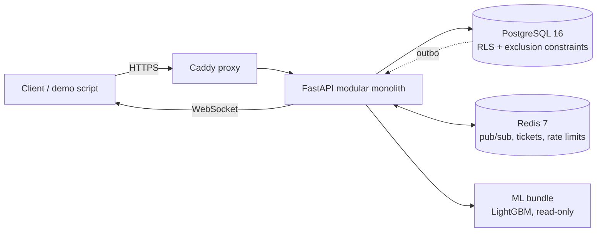

# QueueCare

**Smarter appointments. Shorter waiting. Better clinic management.**

A multi-tenant clinic queue and appointment platform with a wait-time prediction model. The backend, database, ML
pipeline, real-time layer, notifications, analytics and deployment stack are built and tested. **The web app covers patients, front desk, doctors and clinic admins** (booking, live queue board, insights, simulation lab, clinic setup), is covered by 16 browser tests, and runs behind HTTPS in a local production rehearsal. It has not been deployed to a real host or tested on phones. The full system is also available through its HTTP API (a runnable
walkthrough script is included).

> ⚠️ **Demonstration system.** All data is synthetic. QueueCare is not a clinical record system and claims no
> regulatory compliance (HIPAA, GDPR or otherwise). Do not enter real patient data.

## What exists, and what does not

| Area | State |
|---|---|
| Multi-tenant API (about 70 HTTP endpoints + 1 WebSocket), auth, RBAC, audit log | Built, tested |
| PostgreSQL with row-level security and exclusion constraints | Built, tested on a real database |
| Appointments, live queue state machine, real-time updates (outbox + Redis pub/sub) | Built, tested |
| Wait-time model (LightGBM quantile) trained on a **synthetic** simulator, SHAP explanations, drift monitoring | Built; numbers below are synthetic-on-synthetic |
| Notifications (in-app, email, SMS) | Built with **mock providers only**: nothing is ever sent |
| Analytics, slot-length advice, simulation lab | Built, tested |
| Production Docker stack (HTTPS proxy, backups, restore drill) | Rehearsed locally on Docker Desktop; **never deployed to a real host** |
| CI (GitHub Actions: backend, frontend, browser tests, production stack, secret scan) | **All five jobs pass** (run #4, 2026-11-18, about 11 minutes) |
| Frontend, patient screens (Next.js): auth, join clinic, book/cancel, live queue | Built; browser-tested and used by hand ([docs/frontend.md](docs/frontend.md)) |
| Frontend staff queue board with WebSocket updates | Built; browser-tested and used by hand, including live updates through the HTTPS proxy |
| Frontend admin screens (insights, estimate quality, slot advice, simulation lab) | Browser-tested (every tab loads, the lab runs); numbers not reviewed against real data |
| Frontend browser tests (Playwright, 16 tests) | **Pass** on the dev stack and in CI on GitHub |
| Production web-app image behind Caddy (F4) | Built and run locally behind Caddy on Docker Desktop (2026-11-16): landing, register/sign-in, API routing and live updates over HTTPS verified by hand; **not deployed to a real host, no browser tests against it** |
| Clinic setup screens (departments, doctors, weekly hours, time off, team) | Used by the browser tests (16 pass on the dev stack) and type-checked; not tested on phones |
| Platform-admin screens, screenshots, public demo | **Not built** |

Full list of gaps: [docs/limitations.md](docs/limitations.md).

## Verified so far

**436 automated tests pass** (run in Docker against real PostgreSQL 16 and Redis 7), covering tenant isolation,
authorization on every route, concurrent booking (exactly one winner), queue token uniqueness, WebSocket auth,
notification idempotency, ML pipeline behaviour, and a route inventory that fails if any endpoint is left open.
The test suite is about 5,300 lines against about 8,400 lines of application and ML code.

Wait-time model, measured on the held-out test split of the **synthetic** data (seed 42, details and caveats in
[docs/ml.md](docs/ml.md)):

| | MAE (min) | median abs error (min) |
|---|---|---|
| naive "people ahead × recent mean" | 9.13 | 1.82 |
| **LightGBM median (served)** | **7.37** | **1.75** |

The edge over the naive baseline is small, the model under-predicts long queues (6+ people ahead: MAE 60 min), and
the 80% interval covers 87% overall but only 67.5% for long queues. These measure the simulator, not a real clinic.

## Architecture



Details: [architecture](docs/architecture.md), [database](docs/database.md), [security](docs/security.md),
[key decisions](docs/decisions.md).

## Try it

Prerequisites: Docker Desktop, Python 3.12 (for the demo script only).

```powershell
copy .env.example .env          # then replace every CHANGE_ME (see docs/setup.md)
docker compose up -d postgres redis backend
docker compose run --rm backend alembic upgrade head
docker compose run --rm backend pytest -v                 # 436 tests
docker compose run --rm -e QUEUECARE_ADMIN_PASSWORD="<strong password>" backend python -m app.cli create-superadmin --email platform@example.com
$env:QUEUECARE_ADMIN_PASSWORD = "<same password>"
python scripts/demo_walkthrough.py --platform-email platform@example.com
```

The walkthrough (at most twice an hour: registration is rate-limited to 10 per hour per IP) registers a clinic, staff, a doctor and a patient through the real API, books an appointment, runs a
live queue, then prints the wait estimate, analytics and a simulation. Train the ML model (otherwise estimates use a
clearly labelled heuristic): `docker compose run --rm backend python -m ml.training.run --seed 42 --promote`.

## Documentation

| | |
|---|---|
| [Setup](docs/setup.md) | Development environment |
| [Architecture](docs/architecture.md), [Database](docs/database.md) | Design and ER diagram |
| [Security](docs/security.md), [Testing and hardening](docs/testing-and-hardening.md) | Threat model, controls, test strategy |
| [Real-time](docs/realtime.md), [Notifications](docs/notifications.md), [Analytics](docs/analytics.md) | Subsystems |
| [ML](docs/ml.md), [ML report (seed 42)](docs/ml-report-seed42.md), [Advanced features](docs/advanced.md) | Model, measured results, explanations, drift, simulation |
| [Frontend](docs/frontend.md) | Next.js app: what exists, how to verify |
| [Deployment](docs/deployment.md) | Production stack, backups, restore drill |
| [Decisions](docs/decisions.md), [Limitations](docs/limitations.md), [Case study](docs/case-study.md), [Roadmap](docs/roadmap.md) | Why it is built this way, and what is missing |

## License

See [LICENSE](LICENSE).
