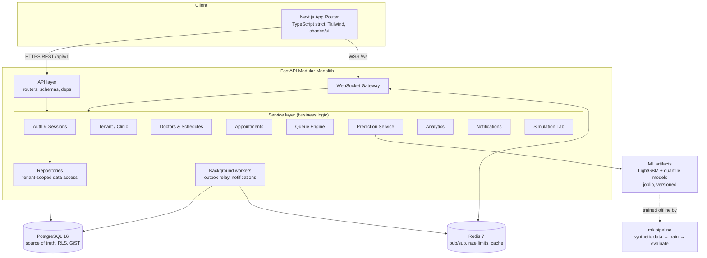
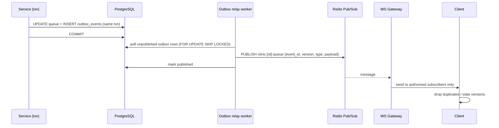

# QueueCare — Technical Architecture

> **QueueCare is a demonstration system.** It uses synthetic data only and is not a production clinical record system. No regulatory compliance (HIPAA, GDPR, etc.) is claimed.

## 1. Architectural Style

A **modular monolith**: one deployable FastAPI service organised into strongly separated modules that talk through service-layer interfaces. Modules can later be extracted into services without rewriting business logic.



## 2. Layering Rules

| Layer | Responsibility | May depend on |
|---|---|---|
| `api/v1` | HTTP routing, request/response schemas, auth dependencies | schemas, services |
| `services` | Business rules, transactions, event emission | repositories, other services (via interface) |
| `repositories` | SQLAlchemy queries, always tenant-scoped | models |
| `models` | ORM definitions | — |
| `permissions` | RBAC matrix, tenant access checks | models |
| `websocket` | Connection auth, channel authorisation, fan-out | services, Redis |
| `workers` | Outbox relay, notification dispatch, reminders | services |

Route handlers contain **no business logic**.

## 3. Multi-Tenancy

- **Model:** shared database, shared schema, `clinic_id` on every clinic-owned row.
- **Membership:** `clinic_memberships(user_id, clinic_id, role)`. A user's access to a clinic is derived only from membership rows, never from a client-supplied `clinic_id`.
- **Enforcement (defence in depth):**
  1. Request-scoped `TenantContext` resolved from the authenticated user and verified against memberships.
  2. Repositories require a `TenantContext`; unscoped queries are not exposed.
  3. PostgreSQL Row-Level Security policies keyed on `current_setting('app.current_clinic_id')`, set per transaction (`SET LOCAL`). The application DB role is not the table owner and does not have `BYPASSRLS`.
  4. WebSocket channels are named `clinic:{id}:...` and subscription is authorised against memberships.
  5. Cache keys are prefixed with clinic id (and user id when authorisation-sensitive).
  6. Automated cross-tenant tests for every endpoint group.
- **Super admin:** platform-level role with explicit, audited cross-tenant endpoints; does not silently bypass tenant scoping on clinic endpoints.

## 4. Authentication & Session Design

- Argon2id password hashing.
- Short-lived access JWT (≈10–15 min) and opaque, rotating refresh token (≈7–14 days), both in `Secure; HttpOnly; SameSite` cookies. Nothing in `localStorage`.
- Refresh tokens stored **hashed** in `refresh_tokens`, grouped by `family_id`. Reuse of a rotated token revokes the whole family (reuse detection).
- `sessions` table tracks device/IP/last-seen for session listing and remote logout.
- CSRF: double-submit token header for state-changing cookie-authenticated requests, plus `Origin` checking.
- Login throttling: Redis counters per IP and per account with progressive back-off; lockout state mirrored in PostgreSQL.
- Password reset: single-use, hashed, expiring tokens; generic responses to prevent user enumeration.
- Email verification behind a provider interface (mock provider initially).

## 5. Appointment Integrity

Double booking is prevented **in PostgreSQL**, not in application code:

```sql
CREATE EXTENSION IF NOT EXISTS btree_gist;

ALTER TABLE appointments
  ADD CONSTRAINT appointments_no_doctor_overlap
  EXCLUDE USING gist (
    doctor_id WITH =,
    tstzrange(starts_at, ends_at, '[)') WITH &&
  ) WHERE (status IN ('PENDING','CONFIRMED','CHECKED_IN','IN_PROGRESS'));
```

- `ends_at` includes the doctor's buffer time so buffers cannot be double-booked.
- Cancelled / no-show / completed rows fall outside the partial constraint and free the slot.
- The service catches `ExclusionViolation` (SQLSTATE `23P01`) and maps it to **HTTP 409**.
- Reschedule is a single transaction: insert new row (constraint checked) → cancel old row. Failure rolls back everything.
- Slot calculation = doctor schedule windows − time off − existing active appointments, split by slot duration + buffer, restricted by clinic booking-horizon and minimum-notice settings.

## 6. Queue Engine

- **Tokens:** `queue_tokens(clinic_id, queue_date, prefix, sequence_no)` with a unique constraint. Sequence is allocated with one atomic `INSERT … ON CONFLICT DO UPDATE … RETURNING` on a per-(clinic, date, prefix) counter row; the row lock serializes concurrent registrations, so there are no duplicates and no gaps. Formatted as `A-001`.
- **State machine:** `WAITING → CALLED → IN_CONSULTATION → COMPLETED`, with `SKIPPED`, `CANCELLED`, `NO_SHOW` branches. Illegal transitions are rejected in the service layer and every transition is written to `queue_token_events` (append-only audit trail).
- **Ordering policy** (configurable per clinic): appointment commitment time, arrival/registration time, optional priority class. Manual reordering requires a reason, stored in `queue_token_events`.
- **Patients** can read their own token and position only; they cannot mutate queue order.
- Concurrency: queue mutations run in a transaction that locks the affected doctor's queue rows.

## 7. Real-Time Pipeline



- **Transactional outbox** guarantees an event is never lost after commit; delivery is at-least-once, so clients deduplicate by `event_id` and discard messages with a lower `version`.
- Redis is transient only. On reconnect, clients re-fetch authoritative state over REST, then resume the stream.
- WS auth uses a short-lived (30 s), single-use ticket obtained via an authenticated REST call (avoids putting long-lived tokens in URLs). The server, not the client, chooses each connection's channels. Full protocol: [realtime.md](realtime.md). Per-user and per-IP connection caps, strict message schemas, and server-side channel authorisation.
- Payloads are minimised: patients receive token number, position and estimate, never other patients' identities.

## 8. ML Pipeline

```mermaid
flowchart LR
    GEN[Synthetic data generator<br/>queueing simulation, seeded] --> DS[(dataset.parquet<br/>labelled SYNTHETIC)]
    DS --> PRE[Preprocessing<br/>time-aware split]
    PRE --> TRAIN[Train: baseline, LR, RF, GBR, LightGBM]
    TRAIN --> Q[LightGBM quantile models<br/>q10 / q50 / q90]
    Q --> EVAL[Evaluation<br/>MAE RMSE R² coverage width<br/>error slices]
    EVAL --> REG[(model_versions + joblib artifacts)]
    REG --> SERVE[Prediction service<br/>loaded once, versioned]
    SERVE --> LOG[(prediction_logs)]
    LOG --> MON[Monitoring: error, coverage, drift]
```



- Training is fully offline and reproducible (`--seed`). The API never retrains.
- Splits are **chronological** (train / validation / test); hyperparameters tuned on validation only; test touched once.
- Leakage controls: features computed using only information available at prediction time; no target-derived columns.
- Metrics and results are generated by the pipeline and reported verbatim. None are pre-written.
- Model files live outside any served path and are never exposed over HTTP.

## 9. Notifications and analytics (Phase 8)
Notifications are rows in `notifications`, created in the caller's transaction (idempotent via a unique key) and delivered by a claim/lease worker with retries and back-off through `NotificationProvider` mocks (email, SMS); IN_APP rows are the delivery itself. Clinic analytics are read-only SQL aggregates for clinic admins. Details: [notifications.md](notifications.md), [analytics.md](analytics.md).

## 10. Observability & Reliability

Structured JSON logging with secret/PII redaction, `/health/live` and `/health/ready` endpoints, request timeouts, graceful shutdown, connection pooling, and an error-monitoring abstraction (no-op by default).

## 11. Key Decisions & Assumptions

| Decision | Rationale |
|---|---|
| Modular monolith | Simpler to build, test and deploy; boundaries preserved for later extraction |
| Shared schema + RLS | Cost-effective multi-tenancy with a database-level safety net |
| Cookie-based sessions | Avoids token storage in JS; requires CSRF handling |
| Opaque rotating refresh tokens | Revocable, supports reuse detection |
| Transactional outbox | No lost events after commit |
| Python 3.12 pinned in containers | Matches spec. The sandbox default is 3.13; `python3.12` is also present |
| PostgreSQL 16 | Current, supports all required features |
| Patients are global users with per-clinic `patients` profile rows | One login, isolated per-clinic records |
| Token prefix per doctor/department queue | Keeps tokens short and unique per queue context |

## 12. ML wait-time prediction (Phase 7)
Offline pipeline in `ml/` (synthetic data → shared feature code → LightGBM quantile models → versioned bundle). The API loads the promoted bundle lazily, caches it per version, and falls back to a labelled heuristic when no model is available. Details, limitations and run commands: [docs/ml.md](ml.md).

## 13. Advanced features (Phase 9)
Explanations, alternative doctors, drift monitoring, slot-length suggestions and the simulation lab sit on top of the Phase 7 model and Phase 8 data without schema changes: pure logic in `ml/monitoring`, `ml/simulation` and `app/services/*_logic.py`, thin services, admin-only routes. Details and limits: [docs/advanced.md](advanced.md).
