# QueueCare — Database Design (Initial ER Diagram)

PostgreSQL 16. UUID primary keys (`gen_random_uuid()`), all timestamps `timestamptz` stored in UTC, `created_at` / `updated_at` on every table. Clinic-local time is derived from `clinics.timezone` at display time.

## ER Diagram

```mermaid
erDiagram
    clinics ||--o{ clinic_memberships : has
    users ||--o{ clinic_memberships : belongs
    clinics ||--o{ departments : has
    clinics ||--o{ doctors : employs
    departments ||--o{ doctors : groups
    users ||--o| doctors : "is (optional link)"
    doctors ||--o{ doctor_schedules : has
    doctors ||--o{ doctor_time_off : has
    clinics ||--o{ patients : registers
    users ||--o{ patients : "has profile at clinic"
    patients ||--o{ appointments : books
    doctors ||--o{ appointments : serves
    clinics ||--o{ appointments : owns
    appointments ||--o| queue_tokens : "may create"
    patients ||--o{ queue_tokens : holds
    doctors ||--o{ queue_tokens : "assigned to"
    clinics ||--o{ queue_tokens : owns
    clinics ||--o{ queue_counters : owns
    queue_tokens ||--o{ queue_token_events : logs
    queue_tokens ||--o| consultations : produces
    doctors ||--o{ consultations : performs
    queue_tokens ||--o{ prediction_logs : predicted
    model_versions ||--o{ prediction_logs : used_by
    clinics ||--o{ notifications : owns
    users ||--o{ notifications : receives
    users ||--o{ sessions : has
    sessions ||--o{ refresh_tokens : issues
    users ||--o{ password_reset_tokens : requests
    clinics ||--o{ audit_logs : scopes
    users ||--o{ audit_logs : acts
    clinics ||--o{ outbox_events : emits

    clinics {
        uuid id PK
        text name
        text slug UK
        text timezone
        text status "PENDING|ACTIVE|SUSPENDED"
        jsonb settings "slot, buffer, policy"
        timestamptz created_at
        timestamptz updated_at
    }
    users {
        uuid id PK
        citext email UK
        text password_hash "argon2id"
        text full_name
        text phone
        text platform_role "NONE|SUPER_ADMIN"
        bool email_verified
        int failed_login_count
        timestamptz locked_until
        bool is_active
    }
    clinic_memberships {
        uuid id PK
        uuid clinic_id FK
        uuid user_id FK
        text role "CLINIC_ADMIN|RECEPTIONIST|DOCTOR|PATIENT"
        bool is_active
    }
    departments {
        uuid id PK
        uuid clinic_id FK
        text name
        text queue_prefix
    }
    doctors {
        uuid id PK
        uuid clinic_id FK
        uuid department_id FK
        uuid user_id FK "nullable"
        text display_name
        int default_slot_minutes
        int buffer_minutes
        text status "AVAILABLE|BUSY|DELAYED|OFF_DUTY"
        int current_delay_minutes
    }
    doctor_schedules {
        uuid id PK
        uuid clinic_id FK
        uuid doctor_id FK
        smallint day_of_week
        time start_time
        time end_time
        date valid_from
        date valid_to
    }
    doctor_time_off {
        uuid id PK
        uuid clinic_id FK
        uuid doctor_id FK
        tstzrange period
        text reason
    }
    patients {
        uuid id PK
        uuid clinic_id FK
        uuid user_id FK "nullable for walk-ins"
        text full_name "synthetic"
        text phone
        date date_of_birth "synthetic"
        bool is_synthetic
        timestamptz deleted_at "soft delete"
    }
    appointments {
        uuid id PK
        uuid clinic_id FK
        uuid doctor_id FK
        uuid patient_id FK
        timestamptz starts_at
        timestamptz ends_at "includes buffer"
        text status "PENDING|CONFIRMED|CHECKED_IN|IN_PROGRESS|COMPLETED|CANCELLED|NO_SHOW"
        uuid rescheduled_from FK
        text cancel_reason
    }
    queue_counters {
        uuid clinic_id FK
        date queue_date
        text prefix
        int last_sequence
    }
    queue_tokens {
        uuid id PK
        uuid clinic_id FK
        uuid doctor_id FK
        uuid patient_id FK
        uuid appointment_id FK "nullable"
        date queue_date
        text prefix
        int sequence_no
        text token_label "A-001"
        text source "WALK_IN|APPOINTMENT"
        text status "WAITING|CALLED|IN_CONSULTATION|COMPLETED|SKIPPED|CANCELLED|NO_SHOW"
        int priority
        timestamptz arrived_at
        timestamptz called_at
        timestamptz started_at
        timestamptz completed_at
        bigint version
    }
    queue_token_events {
        uuid id PK
        uuid clinic_id FK
        uuid token_id FK
        uuid actor_user_id FK
        text from_status
        text to_status
        text reason "required for manual reorder"
    }
    consultations {
        uuid id PK
        uuid clinic_id FK
        uuid token_id FK
        uuid doctor_id FK
        timestamptz started_at
        timestamptz ended_at
        int duration_minutes
        int actual_wait_minutes
    }
    model_versions {
        uuid id PK
        text version UK
        text algorithm
        jsonb metrics
        jsonb feature_schema
        text artifact_ref "internal only"
        bool is_active
        timestamptz trained_at
    }
    prediction_logs {
        uuid id PK
        uuid clinic_id FK
        uuid token_id FK
        uuid model_version_id FK
        float pred_lower
        float pred_median
        float pred_upper
        float actual_wait
        float abs_error
        int latency_ms
        jsonb feature_snapshot "synthetic only"
        timestamptz predicted_at
    }
    notifications {
        uuid id PK
        uuid clinic_id FK
        uuid user_id FK
        text channel "EMAIL|SMS|IN_APP"
        text type
        text status "PENDING|SENT|FAILED|READ"
        int attempts
        text idempotency_key UK
        jsonb payload
        timestamptz next_attempt_at
    }
    audit_logs {
        uuid id PK
        uuid clinic_id FK "nullable (platform)"
        uuid actor_user_id FK
        text action
        text entity_type
        uuid entity_id
        jsonb metadata
        inet ip
    }
    sessions {
        uuid id PK
        uuid user_id FK
        text user_agent
        inet ip
        timestamptz last_seen_at
        timestamptz revoked_at
    }
    refresh_tokens {
        uuid id PK
        uuid session_id FK
        uuid family_id
        text token_hash UK
        timestamptz expires_at
        timestamptz used_at
        timestamptz revoked_at
    }
    password_reset_tokens {
        uuid id PK
        uuid user_id FK
        text token_hash UK
        timestamptz expires_at
        timestamptz used_at
    }
    outbox_events {
        uuid id PK
        uuid clinic_id FK
        text channel
        text event_type
        jsonb payload
        bigint version
        timestamptz published_at
    }
```

Tables beyond the 16 required: `doctor_time_off`, `queue_counters`, `queue_token_events`, `password_reset_tokens`, `outbox_events`.

## Key Constraints

| Table | Constraint | Purpose |
|---|---|---|
| `appointments` | `EXCLUDE USING gist (doctor_id WITH =, tstzrange(starts_at, ends_at,'[)') WITH &&) WHERE status IN (active)` | Prevent double booking (needs `btree_gist`) |
| `appointments` | `CHECK (ends_at > starts_at)` | Valid range |
| `queue_tokens` | `UNIQUE (clinic_id, queue_date, prefix, sequence_no)` | Token uniqueness |
| `clinic_memberships` | `UNIQUE (clinic_id, user_id, role)` | No duplicate roles |
| `departments` | `UNIQUE (clinic_id, name)`, `UNIQUE (clinic_id, queue_prefix)` | Per-tenant naming |
| `doctor_schedules` | `CHECK (end_time > start_time)`; `CHECK (day_of_week BETWEEN 0 AND 6)` | Valid windows |
| `refresh_tokens` | `UNIQUE (token_hash)` | Lookup + integrity |
| `notifications` | `UNIQUE (idempotency_key)` | No duplicate sends |
| Composite FKs | `(clinic_id, doctor_id)` etc. referencing `(clinic_id, id)` | Block cross-tenant references at DB level |

## Planned Indexes

`(clinic_id)` on all tenant tables; `appointments (clinic_id, doctor_id, starts_at)`; `appointments (clinic_id, status, starts_at)`; `queue_tokens (clinic_id, doctor_id, queue_date, status)`; `patients (clinic_id, phone)` and `(clinic_id, lower(full_name))`; `notifications (status, next_attempt_at)`; `outbox_events (published_at) WHERE published_at IS NULL`; `prediction_logs (clinic_id, predicted_at)`; `audit_logs (clinic_id, created_at)`.

## Row-Level Security

Enabled on every tenant table with `USING (clinic_id = current_setting('app.current_clinic_id')::uuid)`. The app sets the value per transaction with `SET LOCAL`. Platform-level routes use a separate, audited code path. Applied in Phase 2 migrations.

## Cascade Policy

- Tenant-owned children: `ON DELETE RESTRICT` by default (clinics are suspended, not hard-deleted).
- Pure dependents (`refresh_tokens` → `sessions`, `queue_token_events` → `queue_tokens`): `ON DELETE CASCADE`.
- Patient removal is **soft delete** (`deleted_at`) to preserve queue and consultation history.

## Migration 0002 (Phase 3)

- `uq_doctors_clinic_user`: unique `(clinic_id, user_id)` where `user_id IS NOT NULL` (one doctor profile per account per clinic).
- `doctor_schedules_no_overlap`: `EXCLUDE USING gist (doctor_id =, day_of_week =, tsrange(start,end,'[)') &&, daterange(valid_from, valid_to,'[]') &&)`. NULL validity dates mean open-ended; touching windows (09:00-12:00 / 12:00-15:00) are allowed.

## Phase 4 notes

No new migration: `patients` and `appointments` (with the exclusion constraint) come from migration 0001. `appointments.ends_at` includes the doctor's buffer, so the constraint also protects buffer time. `ACTIVE_APPOINTMENT_STATUSES` in `app/permissions/roles.py` must match the constraint's `WHERE status IN (...)` clause.

## Phase 5 notes

Queue tables come from migration 0001; migration 0003 adds integrity constraints (partial unique indexes and two CHECKs). `LIVE_TOKEN_STATUSES` / `ACTIVE_TOKEN_STATUSES` in `app/permissions/roles.py` must match the index WHERE clauses. Verified by applying 0001→0003 on PostgreSQL 16, exercising each constraint with rows, and a downgrade/re-upgrade round trip.

## Phase 6 notes

No new migration. `outbox_events` (migration 0001) is written in the same transaction as the change that caused it and published by the relay. Verified on PostgreSQL 16 as the restricted application role: inserts under the tenant context, rejection of cross-clinic inserts, zero rows without a context, and the relay's `FOR UPDATE SKIP LOCKED` / mark / purge statements under the platform context.

## Phase 7 notes
No migration: `model_versions` and `prediction_logs` already exist from 0001. Phase 7 adds ORM models (`app/models/ml.py`). `model_versions` is global (not clinic-scoped) with a single-active partial unique index; `prediction_logs` is clinic-scoped with `lower ≤ median ≤ upper` enforced by a CHECK, and `token_id` is set to NULL (not cascaded) if the token is ever removed.

## Phase 8 notes
No migration: `notifications` already exists from 0001 (unique `idempotency_key`, `(status, next_attempt_at)` index, tenant RLS). Rows hold a `payload` with the minimum needed to render the message later. IN_APP rows are inserted as `SENT` and become `READ`; EMAIL/SMS rows start `PENDING`. `attempts` is incremented when a row is *claimed*, and `next_attempt_at` doubles as the lease and the back-off timer. Analytics read existing tables only.
